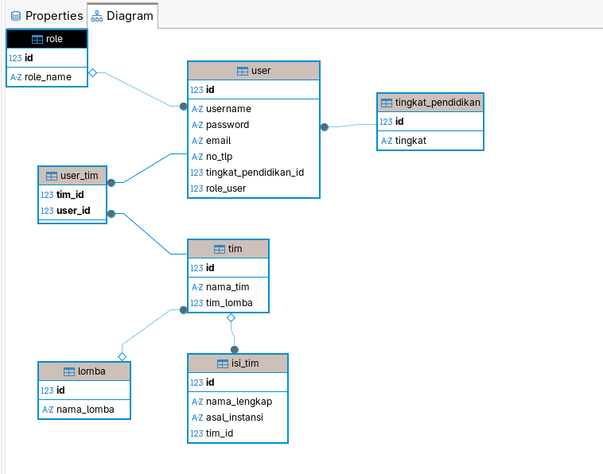

# anforcom

# install bun

1. Arch Linux
```bash
sudo pacman -S bun
```

To install dependencies:

```bash
bun install
```

To run:

```bash
bun --watch --hot backend/index.ts
```

This project was created using `bun init` in bun v1.3.11. [Bun](https://bun.com) is a fast all-in-one JavaScript runtime.


# Backend to do
- tambah middleware untuk /dashboard
- tambah otp untuk verifikasi email
- tambah endpoint create_team
 



## Create account
```nginx
curl -i -w "\n\n[INFO] Waktu Total Respons: %{time_total} detik\n" \
-X POST http://127.0.0.1:1337/api/auth/create_account \
-H "Content-Type: application/json" \
-d '{"username": "galvintest", "password": "galvin123", "email": "galvindoserr@gmail.com", "no_tlp": "0848992297874", "tingkat_pendidikan": 1}'
```

tingkat_pendidikan 1 = mahasiswa
tingkat_pendidikan 2 = sma/sederajat

Response dari Server

```nginx
HTTP/1.1 200 OK
Content-Type: application/json;charset=utf-8
Date: Sun, 28 Jun 2026 08:39:23 GMT
Content-Length: 93

{"success":true,"message":"Successfully created galvintest please relogin to get session_id"}

[INFO] Waktu Total Respons: 0.099673 detik
```

## Login
```curl
 curl -i -w "\n\n[INFO] Waktu Total Respons: %{time_total} detik\n" \
 -X POST http://127.0.0.1:1337/api/auth/login \
 -H "Content-Type: application/json" \
 -d '{"username": "galvintest", "password": "galvin123"}'
```

response dari server

```nginx
HTTP/1.1 200 OK
set-cookie: session=2aA9dEHvjblIeSZhKbTTnOwbuufZIgeqy6TQGj2LDc1w6pStytZRbd7A1kG5dORH_auBr5BJCKImhlTEAzmnu7hJeOJ2oBIN_kjOVAc5Ju_NAWUor-B97tEzaEtbQlQJiFIP5eJ8tZzZG4C85uPSGRXDooHOlHnJLCFs68qzDcg4ilZVk1Rd3tYdrb4gQhBeUUWmBvoPNmm7Nn_Gqgjir_wWSQdUcP3upgs; HttpOnly; Path=/; Max-Age=86400
Content-Type: application/json;charset=utf-8
Date: Sun, 28 Jun 2026 08:40:53 GMT
Content-Length: 16

{"success":true}

[INFO] Waktu Total Respons: 0.094432 detik
```

## Mengambil informasi untuk show di frontend

```curl
  curl -i -w "\n\n[INFO] Waktu Total Respons: %{time_total} detik\n" \
  -X GET http://127.0.0.1:1337/api/user/me \
  -H "Cookie: session=valid_session"
```

Response dari server

```nginx
HTTP/1.1 200 OK
Content-Type: application/json;charset=utf-8
Date: Sun, 28 Jun 2026 08:42:33 GMT
Content-Length: 101

{"username":"galvintest","email":"galvindoserr@gmail.com","no_tlp":"0848992297874","pendidikan_id":1}

[INFO] Waktu Total Respons: 0.001074 detik
```
